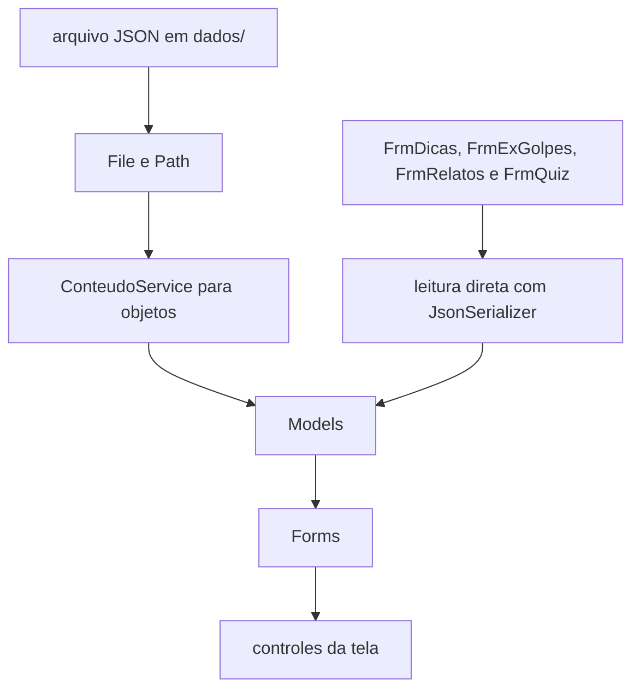

# 02 — Visão geral do projeto

## Mapa de pastas e arquivos

| Arquivo/pasta | Para que serve | Nível |
|---|---|---|
| `Program.cs` | Inicia o Windows Forms e abre o menu. | 🟢 |
| `Models/*.cs` | Moldes dos dados lidos do JSON. | 🟢 |
| `Services/ConteudoService.cs` | Localiza e desserializa objetos JSON. | 🟡 |
| `Services/Responsivo.cs` | Reaplica fontes conforme o tamanho da janela. | 🔴 |
| `Forms/FrmMenu.cs` | Menu inicial e abertura das telas. | 🟢 |
| `Forms/FrmBiblioteca.cs` | Menu de dicas, relatos e golpes. | 🟢 |
| `Forms/FrmDicas.cs` | Navega pelas dicas carregadas. | 🟡 |
| `Forms/FrmExGolpes.cs` | Navega pelos exemplos de golpes. | 🟡 |
| `Forms/FrmRelatos.cs` | Navega pelos relatos. | 🟡 |
| `Forms/FrmCreditos.cs` | Mostra créditos e logos opcionais. | 🟡 |
| `Forms/FrmQuiz.cs` | Carrega perguntas, embaralha alternativas e calcula pontos. | 🟡 |
| `Forms/*.Designer.cs` | Montagem visual automática dos Forms. | 🟡 |
| `dados/*.json` | Conteúdo editável fora do código. | 🟢 |
| `ProtetorDigital.csproj` | Configura o projeto e a cópia dos dados. | 🟡 |
| `*.resx` | Recursos gerenciados pelo Visual Studio. | 🟡 |
| `imagens/*` | Imagens existentes no repositório. | 🟢 |

## Fluxo principal real

1. `Program.Main` chama `ApplicationConfiguration.Initialize`.
2. `Application.Run(new FrmMenu())` abre o menu.
3. O menu abre Quiz e Biblioteca com `Show()` e oculta a própria janela.
4. A Biblioteca abre Dicas, Relatos ou Exemplos de Golpes com `Show()` e se oculta.
5. A tela filha usa a referência `_janelaOrigem` para mostrar a origem no retorno.
6. Créditos é a exceção: o menu cria `FrmCreditos` e chama `ShowDialog(this)`, portanto é modal.
7. O botão Sair chama `Application.Exit()`.

> Atenção: o fluxo solicitado mencionava `ShowDialog` para cada tela filha, mas o código atual usa `Show()` para Quiz, Biblioteca e conteúdo. Esta documentação descreve o código real.

## Fluxo de dados

`ConteudoService` é usado diretamente por Créditos. As telas antigas de conteúdo ainda fazem sua própria localização e desserialização, em vez de usar esse serviço. Isso é uma diferença importante entre a arquitetura desejada e a arquitetura atual.

## Fluxo do Quiz

1. `FrmQuiz_Load` procura `dados/perguntas.json` na saída e depois no diretório de desenvolvimento.
2. O texto é lido e convertido para `List<Pergunta>`.
3. `MostrarPergunta` escolhe a pergunta pelo índice.
4. As alternativas são copiadas para uma sequência temporária.
5. `Select` associa cada alternativa à informação de correta.
6. `OrderBy(_ => Random.Shared.Next())` embaralha a cópia, sem mudar o JSON.
7. A nova posição correta fica em `_respostaCorretaExibida`.
8. O usuário marca um `RadioButton` e clica em Confirmar.
9. O método verifica se houve seleção, compara com a posição correta e soma `_pontuacao` quando acerta.
10. Um `MessageBox` mostra feedback e explicação.
11. Se ainda houver perguntas, o índice avança; caso contrário, o quiz termina e retorna à janela de origem.

Não existe histórico persistente de resultados no projeto atual. A pontuação existe apenas enquanto o objeto `FrmQuiz` está aberto.

## Como as telas se encaixam

`Forms` é a camada visual. `Models` são os moldes dos dados. `Services` contém tarefas compartilhadas. Os arquivos JSON são a fonte externa de textos. O `.Designer.cs` monta parte dos controles, enquanto os arquivos `.cs` ligam eventos e executam regras.
